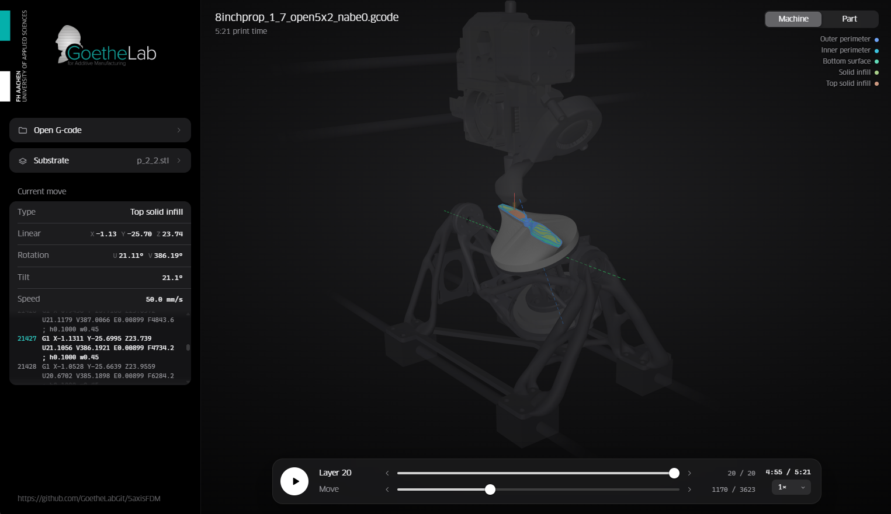

# 5axisFDM

5-axis FDM printing on a tilt-rotary table (Open5x-style, Prusa-based), by [GoetheLab](https://www.goethelab.fh-aachen.de/), FH Aachen.
This repository currently contains the G-code viewer; slicer and mechanical design will follow.



## Viewer

`viewer/gcode_viewer.html` plays back a print on the machine, move by move.

- Open it in Chrome or Edge (needs internet for three.js from a CDN).
- **Open G-code**: robot code (A/B/C), table code (B/C) or machine code (X/Y/Z/U/V).
- **Substrate**: optional STL; origin = plate center on its surface, rotates with the table.
- **Machine / Part**: view with kinematics (B about Y, C about Z, nozzle vertical) or in part coordinates.
- Keys: ←/→ move (Shift ×10), ↑/↓ layer, Space play, M view, S substrate.

### Example

`viewer/examples/`: propeller printed onto a substrate. Open the G-code, then the STL under *Substrate*, rotation −45°.
Served over HTTP (e.g. `python -m http.server` in `viewer/`), it opens directly:

```
http://localhost:8000/gcode_viewer.html?src=examples/propeller.gcode&stl=examples/propeller_substrate.stl&subrot=-45
```
